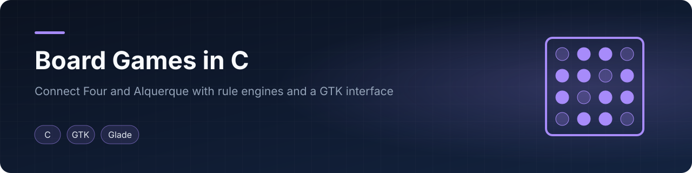

<p align="center"></p>

<p align="center">   </p>
<p align="center"><a href="#english">English</a> · <a href="#español">Español</a></p>

## English

### Overview
This repository contains two board games written in plain C. Each implements its rules from scratch (move validation, capture or four-in-a-row detection, end-of-game conditions) and includes a computer opponent. Connect Four runs in the Windows console; Alquerque has a GTK 3 interface built with Glade. In both games, the computer chooses randomly among moves that pass the same validation used for human players; there is no search or heuristic play.

### Projects
| Project | What it does | Interface | Build |
|---|---|---|---|
| [`connect-four/`](connect-four) | 6x7 Connect Four, human vs computer. Random first player, optional turn limit (1-21 turns each), surrender, tie-break by adjacent-piece score, ASCII-art messages | Console (uses `windows.h` and `system("cls")`) | `gcc CuatroEnRayaFinal.c -o connect4` (Windows) |
| [`alquerque/`](alquerque) | 5x5 Alquerque with 12 pieces per side: validated moves and captures (including chained jumps), single player vs computer, computer vs computer or two players, optional player names | GTK 3 window defined in `play.glade` | `gcc src/alquerque.c -o alquerque $(pkg-config --cflags --libs gtk+-3.0)`, run from the `alquerque/` folder |

### Highlights
- Rules implemented without game libraries: column-fill tracking and four-direction win check for Connect Four; diagonal, orthogonal and jump-capture validation with move-chain rules for Alquerque.
- Input handling: integer parsing with range filtering (Connect Four); syntax and semantic checks of `xy:xy` move strings (Alquerque).
- Alquerque separates game logic from the GTK event callbacks; the console logic was reused behind the GUI.
- Design notes and flow diagrams are included for Alquerque; a written report with data structures and algorithms is included for Connect Four.

### Repository layout
```
connect-four/   src/ (game and message library)
alquerque/      src/alquerque.c, play.glade, Images/, docs/ (flowchart, GUI schematic, move rules)
```

### Known limitations
- The computer opponents are random, not strategic.
- The Alquerque design notes record a crash when generating the computer move in an early GUI version; the final state of that issue was not re-verified here.
- No screenshots of the running programs are included.

### Team & credits
Developed by Elías David Álvarez Martínez and José Pássera at Universidad Católica "Nuestra Señora de la Asunción" (Paraguay), 2022. The Connect Four report is shared for reference.

### License
MIT.

---

## Español

### Descripción general
Este repositorio contiene dos juegos de tablero escritos en C. Cada uno implementa desde cero sus reglas (validación de jugadas, capturas o detección de cuatro en línea, condiciones de fin) e incluye un oponente controlado por la computadora. Cuatro en Raya corre en la consola de Windows; Alquerque tiene una interfaz GTK 3 creada con Glade. En ambos juegos, la computadora elige al azar entre jugadas que pasan la misma validación que las de una persona; no hay búsqueda ni heurística.

### Proyectos
| Proyecto | Qué hace | Interfaz | Compilación |
|---|---|---|---|
| [`connect-four/`](connect-four) | Cuatro en Raya 6x7, persona contra computadora. Primer jugador aleatorio, límite de turnos opcional (1-21 turnos para cada uno), rendición, desempate por puntaje de fichas adyacentes, mensajes en arte ASCII | Consola (usa `windows.h` y `system("cls")`) | `gcc CuatroEnRayaFinal.c -o connect4` (Windows) |
| [`alquerque/`](alquerque) | Alquerque 5x5 con 12 fichas por bando: movimientos y capturas validados (incluidos saltos encadenados), una persona contra la computadora, computadora contra computadora o dos personas, nombres de jugadores opcionales | Ventana GTK 3 definida en `play.glade` | `gcc src/alquerque.c -o alquerque $(pkg-config --cflags --libs gtk+-3.0)`, ejecutar desde la carpeta `alquerque/` |

### Aspectos destacados
- Reglas implementadas sin bibliotecas de juegos: seguimiento del llenado de columnas y comprobación de victoria en cuatro direcciones para Cuatro en Raya; validación diagonal, ortogonal y de capturas por salto con reglas de encadenamiento para Alquerque.
- Manejo de entradas: análisis de enteros con filtrado de rango (Cuatro en Raya); comprobaciones sintácticas y semánticas de cadenas de movimiento `xy:xy` (Alquerque).
- Alquerque separa la lógica del juego de los callbacks de eventos GTK; la lógica de consola se reutilizó detrás de la GUI.
- Se incluyen notas de diseño y diagramas de flujo para Alquerque; Cuatro en Raya incluye un informe escrito sobre estructuras de datos y algoritmos.

### Estructura del repositorio
```
connect-four/   src/ (juego y biblioteca de mensajes)
alquerque/      src/alquerque.c, play.glade, Images/, docs/ (diagrama de flujo, esquema de GUI, reglas de movimiento)
```

### Limitaciones conocidas
- Los oponentes controlados por la computadora son aleatorios, no estratégicos.
- Las notas de diseño de Alquerque registran un cierre inesperado al generar el movimiento de la computadora en una versión temprana de la GUI; el estado final de ese problema no se volvió a verificar aquí.
- No se incluyen capturas de pantalla de los programas en ejecución.

### Equipo y créditos
Desarrollado por Elías David Álvarez Martínez y José Pássera en la Universidad Católica "Nuestra Señora de la Asunción" (Paraguay), 2022. El informe de Cuatro en Raya se comparte como referencia.

### Licencia
MIT.
